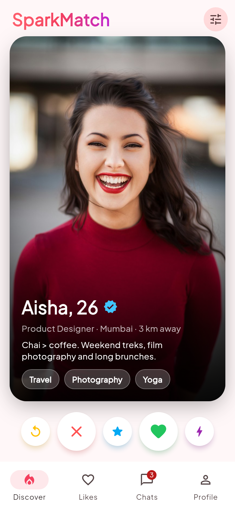
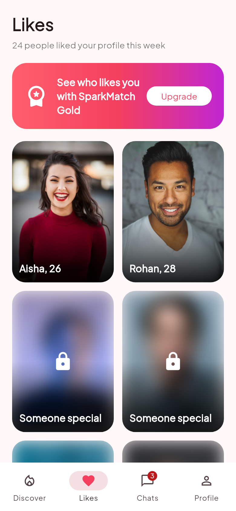
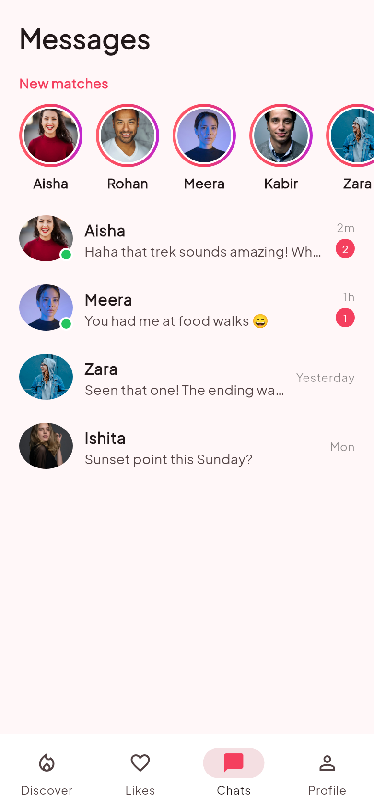
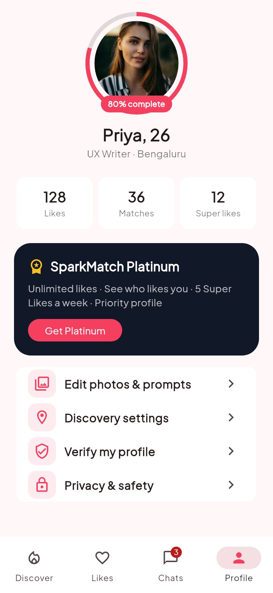

# Dating App Development | Custom Dating Application Solutions

**Build Your Own Dating App with Custom Android, iOS and Web Development**

Looking for a professional **Dating App Development Company** to build your own dating platform, matchmaking application, or social discovery app?

Naya Prayog Technologies provides custom dating app development services for startups, entrepreneurs, and businesses looking to launch their own digital matchmaking platforms.

We help transform dating app ideas into digital products with thoughtfully designed user experiences, user profiles, matching workflows, communication features, privacy controls, and administration capabilities.

Whether you want to build a modern dating application, a niche matchmaking platform, or an interest-based social discovery app, we can help plan and develop a solution around your business requirements.

**Have an idea for a dating app startup? Let's discuss your project.**

---

## Dating App Development Services

Dating app development involves creating digital platforms that help users discover potential matches, connect with other people, communicate, and build meaningful interactions.

Naya Prayog Technologies can help develop custom dating applications based on your target audience, business model, and product requirements.

## Key Dating App Features

The following features represent capabilities that can be planned and implemented depending on the agreed project scope.

### 1. User Registration and Authentication

Create a secure and convenient onboarding experience.

- User registration
- Login and authentication
- Email or phone-based verification
- Profile creation
- Password recovery
- Account management

### 2. User Profile Management

Allow users to create and manage personalized profiles.

- Profile information
- Profile pictures
- Personal preferences
- Profile editing
- Interest information
- Profile visibility settings

### 3. Matchmaking and Discovery

Build discovery experiences that help users find relevant profiles.

- Browse user profiles
- Discover potential matches
- Preference-based discovery
- Interest-based matching
- Profile recommendations
- Match management

### 4. Like and Match Functionality

Develop interaction workflows that support matchmaking experiences.

- Like and interest actions
- Mutual matching workflows
- Match notifications
- Match list management
- Profile interaction history

### 5. Chat and Messaging

Enable communication between matched users.

- One-to-one messaging
- Real-time chat
- Conversation management
- Message notifications
- Media sharing where required
- Chat privacy controls

### 6. Location-Based Discovery

Develop location-aware discovery functionality where appropriate.

- Location-based profile discovery
- Distance preferences
- Location permissions
- Nearby profile discovery
- Location privacy settings

Location-related functionality depends on the selected mapping and location services.

### 7. Notifications and Engagement

Keep users informed about relevant activities.

- New match notifications
- Like notifications
- New message alerts
- Profile interaction notifications
- Push notifications

### 8. Privacy, Safety and Moderation

Build tools that support responsible platform management.

- User blocking
- Profile reporting
- Content moderation workflows
- Account management
- Privacy settings
- User verification workflows where required

Safety, privacy, and moderation requirements should be defined carefully during product planning.

### 9. Subscription and Monetization

Optional monetization capabilities can be planned according to your business model.

- Premium membership plans
- Subscription management
- Paid feature access
- Payment gateway integration
- In-app purchase integration
- Promotional offers

The final payment and subscription implementation depends on platform policies, payment provider requirements, and the agreed scope.

### 10. Admin Dashboard

A web-based administration system can be developed to manage the platform.

- User management
- Profile moderation
- Report management
- Account restrictions
- Subscription administration
- Platform configuration
- Administrative reports and analytics

---

## Types of Dating Applications We Can Develop

### Traditional Dating Applications

Platforms designed to help people discover profiles, express interest, match, and communicate.

### Matchmaking Applications

Applications focused on compatibility, preferences, and structured matchmaking experiences.

### Niche Dating Applications

Specialized dating platforms designed for specific audiences, interests, or communities.

### Location-Based Dating Applications

Applications that incorporate location-aware profile discovery and matching workflows.

### Social Discovery Applications

Platforms combining social networking, profile discovery, and connection functionality.

### Premium Dating Platforms

Membership-based applications with premium subscriptions and additional user experiences.

---

## SparkMatch – Dating App Product Concept

**SparkMatch** is a dating application concept within the Naya Prayog product portfolio.

It represents our interest in developing modern social discovery and matchmaking experiences.

The concept can help demonstrate the type of digital product that can be planned around dating, user discovery, profile interactions, and social connections.

For information about its current development status, feature availability, or commercial opportunities, contact Naya Prayog Technologies.

---

## Who Needs Dating App Development?

Our dating app development services can support:

- Dating app startups
- Entrepreneurs and founders
- Matchmaking businesses
- Social discovery platforms
- Niche community businesses
- Technology companies
- Businesses planning subscription-based applications
- Organizations launching specialized networking platforms

---

## Technology Stack and Development Capabilities

Depending on project requirements, we work with modern technologies for mobile, web, and backend development.

| Technology | Application |
|---|---|
| Flutter | Cross-platform Android and iOS applications |
| Android | Android application development |
| iOS | iPhone application development |
| React / Next.js | Web application development |
| Python / FastAPI | Backend and API development |
| Node.js | Backend services |
| Firebase | Authentication, database, and related services |
| PostgreSQL / MongoDB | Database solutions |

The final technology stack depends on product requirements, expected user volume, scalability, security, and infrastructure.

## Dating App Development Process

1. **Requirement Analysis:** Understand your dating app concept, target audience, and business

<!-- screenshots -->
## Screenshots

<table>
  <tr>
    <td align="center"><b>Discover</b>  </td>
    <td align="center"><b>Likes</b>  </td>
    <td align="center"><b>Chats</b>  </td>
    <td align="center"><b>Profile</b>  </td>
  </tr>
</table>
